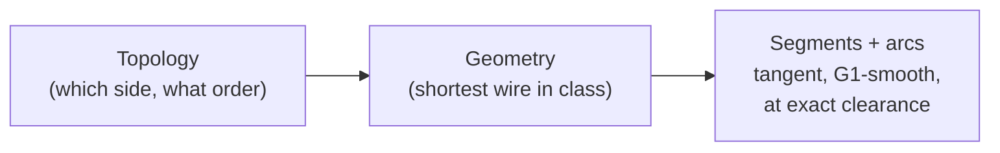
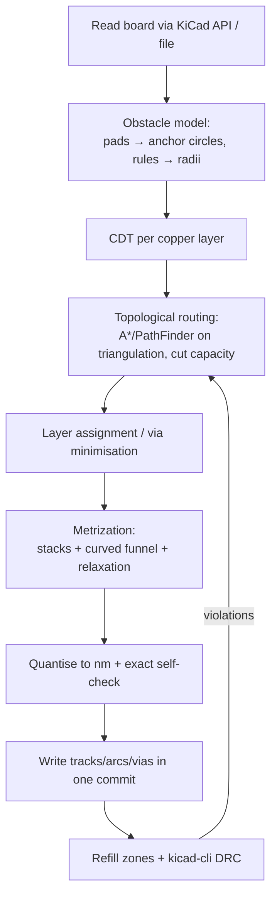

# 00 — Overview: topological routing with smoothly curved, minimal-length traces

## What it is

"Topological routing with smoothly curved, minimal-length traces" is the marketing line of
**TopoR** (Eremex), but the method behind it is a well-documented family of algorithms
going back to the mid-1980s ("rubber-band" or "homotopic" routing). The idea in one
sentence:

> First decide **which side of every obstacle each wire passes** (its *topology*), without
> coordinates; then compute the **unique shortest wire** with that topology that respects
> widths and clearances — which is automatically a chain of **straight tangent segments and
> circular arcs** hugging the obstacles at exactly the required clearance.

Traces have no fixed grid and no preferred directions (any-angle). When a component moves,
the wire shapes can be recomputed from the topology ("flexible" routing).

## Why it works well

- **Minimal length by construction** — the taut wire in a homotopy class is unique and
  shortest; no 45° detours.
- **Smooth (G1)** — tangent segments meet arcs tangentially; no corners, no acid traps from
  routing (pad exits still need care).
- **Fewer vias** — layer assignment works on a global topology; TopoR reports exact via
  minimisation on 2 layers.
- **Efficient use of space** — wires stack as concentric arcs around pads ("spokes"), and the
  routability test (cut capacity) is exact for a given sketch.
- **Constant-gap differential pairs** — offsets of arcs are concentric arcs.

## Why it is hard (and why open-source attempts stalled)

- **Metrization** (topology → exact geometry) with non-circular pads, mixed widths and
  pairwise clearances is the hard part; TopoR's own authors call it the main difficulty.
- **Capacity** on triangulation edges is a necessary, not sufficient, check.
- **Dense, few-layer boards** (fine-pitch escape) defeated gEDA's toporouter and others.
- **Numerics** — arcs stored as integer-nm start/mid/end in KiCad; clearance at the limit
  needs margins.

## The pipeline used in this project

Recommended first step (see [feasibility study](02-feasibility-study.md)): only **F–I on an already routed
board** ("taut-arc smoother"), which tests the hardest stage early.

## How the docs are organised

| Section | Content |
|---|---|
| [topology/](topology/) | triangulation & cut capacity, homotopic shortest paths, sketch generation, vias & layers |
| [geometry/](geometry/) | clearance model, tangent-arc paths & stacks, smoothness & biarcs, exact DRC checks & integer-nm policy, diff pairs & length, relaxation & re-flow |
| [kicad/](kicad/) | what KiCad can store, read, write and verify; rule-engine and API limits; how a Rust engine plugs in (Python IPC plugin + local PyO3 wheel, exec plugin, file CLI) and which Rust crates fit |
| [design/](design/) | pitfalls, lessons from prior attempts, open problems |
| [01-bibliography.md](01-bibliography.md) | annotated literature with links |
| [02-feasibility-study.md](02-feasibility-study.md) | **verdict**, risks, effort, open questions |
| [glossary.md](glossary.md) | terms |

Claims that could not be verified against a primary source are marked **UNVERIFIED**.
Research date: 2026-10-30.
