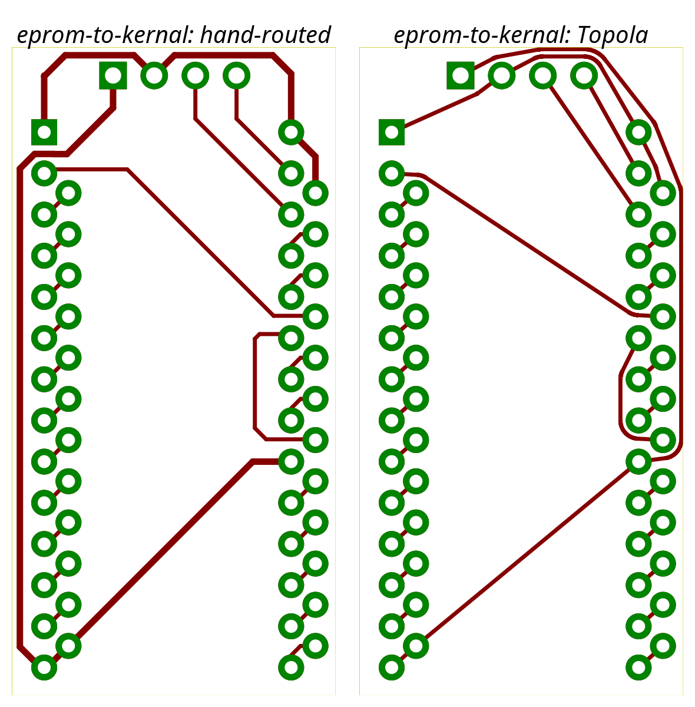
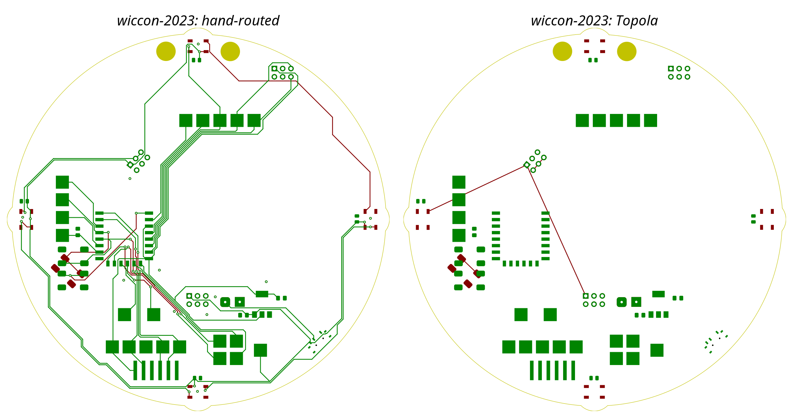
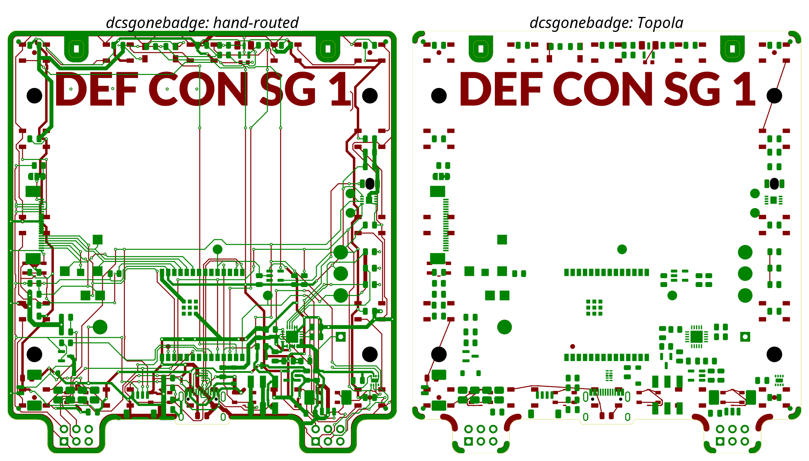

# Run 2026-10-30 — Topola `develop` d832b164 (baseline)

Router: Topola `develop`, commit `d832b164` (2026-07-02), release build, Rust 1.96.
KiCad 10.0.8. Path: KiCad → Specctra DSN → Topola CLI → SES → KiCad. Full analysis:
[43 — Topola assessment](../../design/43-topola-assessment.md).

## Metrics

| Board | Routed | Unconnected | DRC (routing-related) | Length vs hand | Vias | Arcs | Notes |
|---|---|---|---|---|---|---|---|
| eprom-to-kernal | 26/26 (F.Cu only) | 0 | 0 clearance; 199 edge clearance; 16 track width (1 µm leaked wires) | 192 vs 190 mm | 0 | 14 arcs flattened to ~100 chords each | power nets 0.25 mm instead of 0.4 mm; 0.1 s |
| wiccon-2023 | 5 connections (F.Cu) | 54 | — | — | 1 | 1 | B.Cu empty; B.Cu run killed after 1105 s |
| dcsgonebadge (robustness only) | 27 connections (F.Cu) | most | traces through NPTH mounting holes | — | 1 | 0 | B.Cu empty |

## Images

eprom-to-kernal — hand (left) vs Topola (right):

wiccon-2023:

dcsgonebadge (robustness only, not a quality reference):

## Observations

- Taut, partly rounded paths on the simple board; edge clearance unknown to the router
  (not in DSN); per-net widths lost.
- No usable result on boards with parts on B.Cu; NPTH keepouts ignored.
- Raw data: [metrics/](metrics/) (DRC JSON reports, per-net widths, metrics). Paths inside the
  JSON files refer to the temporary evaluation directory.
