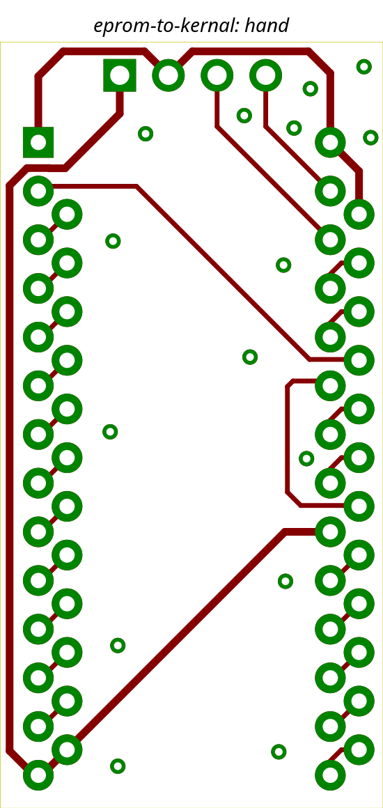
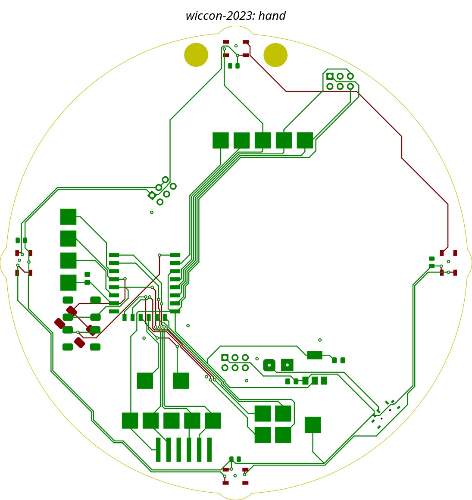
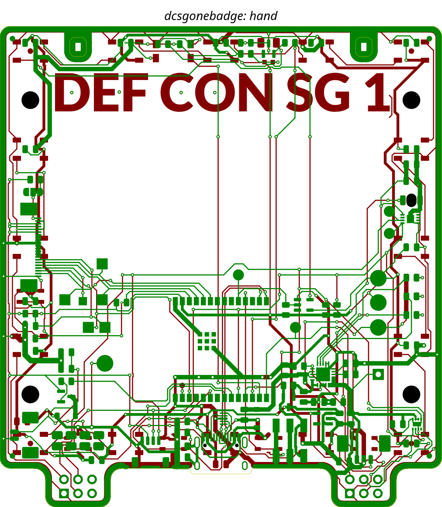

# Run 2026-10-30 — topor 0.0.1 (M0 gate, no router)

Engine `topor-engine` 0.0.1, harness at the M0 gate, KiCad 10.0.8. No router exists yet: the
run is `run_bench(router=None)` on copies of the three benchmark boards (all tracks ripped,
nothing written back). It reproduces the baseline's **hand** images and `orig_*` metrics; the
structure follows [the Topola baseline](../2026-10-30-topola-d832b164/README.md).

## Metrics

| Board | Routed | Orig segs / arcs / vias | Orig track length (segs + arcs) | Orig DRC total (baseline) | Vias kept / removed | Runtime |
|---|---|---|---|---|---|---|
| eprom-to-kernal | — (no router) | 60 / 0 / 15 | 175.56 mm | 0 (re-pinned 2026-10-30, KiCad 10 hand re-route; was 93 on the KiCad 5 board) | 0 / 0 | 6.3 s |
| wiccon-2023 | — | 381 / 0 / 36 | 1831.97 mm | 48 (48) | 11 / 25 | 6.5 s |
| dcsgonebadge | — | 1369 / 14 / 203 | 4210.28 mm (4167.08 + 43.20 arcs) | 192 (210) | 2 / 201 (baseline 7 / 196) | 12.3 s |

Runtime is the whole no-router procedure (copy, DRC before and after, rip, model export, two
renders), all well below the 60 s budget.

## Images

Hand-routed boards as rendered by the harness (`images/*-hand.png`); the baseline's
`-topola.png` images cannot be regenerated (the routed scratch boards no longer exist).

## Observations

- Image reproduction (normalised RMSE of the board area, caption strip cropped, alpha flattened
  onto white, vs the baseline `-hand.png`; eprom is no longer comparable, see below): wiccon 0.0003, dcsgonebadge 0.0025
  (gate bound 0.02); sizes 550x1160, 1095x1160, 1012x1160 as in the baseline.
- eprom-to-kernal (re-pinned 2026-10-30): the source was converted to KiCad 10 and re-routed by
  hand DRC-clean (60 segments + 15 vias, 175.557 mm, 0.4 mm x23 + 0.25 mm x37, 30 wires, board-setup edge
  clearance 0.2 mm). The M0 gate compares its hand image with `images/eprom-to-kernal-hand.png`
  (this run), not with the Topola baseline's (old KiCad 5 board, kept as `-hand-kicad5.png`).
- dcsgonebadge DRC total is 192, not 210: courtyards_overlap 6 (11), lib_footprint_issues 6 (18)
  and starved_thermal 2 (3) depend on the machine's footprint libraries; all other types match.
- dcsgonebadge keeps 2 free vias where the baseline kept 7 (the harness uses pcbnew's
  `GetIsFree()`; the baseline kept vias touching no track). Open item for the rip logic.
- Raw data: [metrics/](metrics/).
