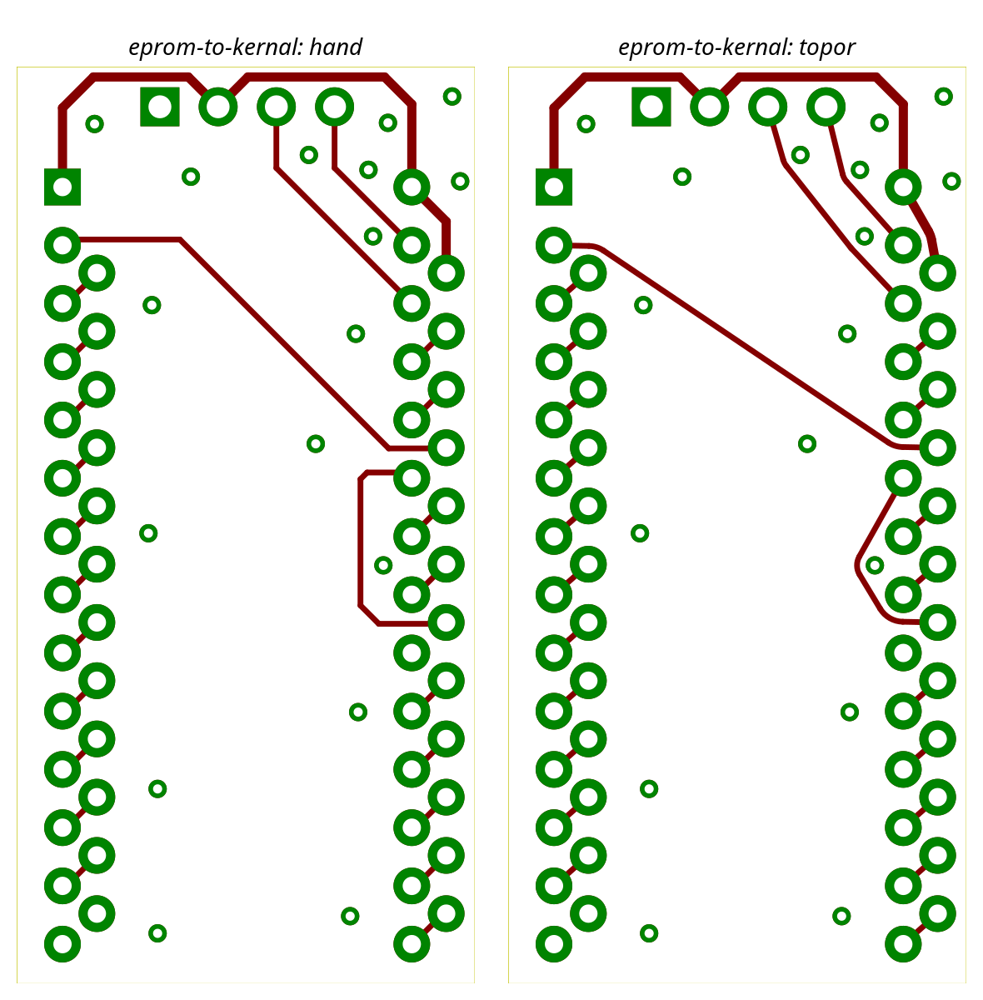

# Run 2026-10-30 — topor 0.1.0 (M1 taut smoother gate)

Engine `topor-engine` 0.1.0 (taut smoother, T9a zero-slack classification, T9c fixes), harness at the M1 gate, KiCad 10.0.8.
wiccon-2023 and dcsgonebadge rows regenerated after T9c (eprom numbers unchanged by T9c).
Run is `run_bench(router=smooth_router, rip="none", options={"existing_copper": "smooth"})` on copies of the three
benchmark boards (`tools/bench.sh <board> <dir> --rip none --router smoother`): the hand copper is converted
to taut chains of segments and native arcs, a wire that cannot be converted keeps its hand copper (fallback).
Structure follows [0.0.1](../2026-10-30-topor-0.0.1/README.md). Gate test: `tests/gate/test_m1_gate.py`.

## Metrics

| Board | Nets taut | Wires taut | Zero-slack fallbacks | Segs / arcs (hand) | Outside-pad length emitted vs hand (gate) | KiCad track+arc vs hand (info) | DRC routing_new | Unconnected | router_s / runtime |
|---|---|---|---|---|---|---|---|---|---|
| eprom-to-kernal | 24 / 26 (GND has no tracks, +5V partial) | 25 / 27 | 2 (wires 22, 23, net +5V) | 41 / 8 (53 / 0) | **71.494 mm vs 76.598 mm** | 114.894 mm vs 112.886 mm | **0** | **0** | 0.005 s / 6.5 s |
| wiccon-2023 (info) | 0 / 38 | 0 / 89 | 0 | 381 / 0 (381 / 0) | 1690.138 vs 1690.138 mm (all fallback) | 1831.971 vs 1831.971 mm | 0 | 0 | 0.010 s / 6.4 s |
| dcsgonebadge (info) | 23 / 86 | 409 / 645 | 23 (236 fallbacks in all, 3 pinned by the DRC loop) | 1183 / 164 (1369 / 14) | 3800.133 vs 3890.918 mm | 4120.565 vs 4210.279 mm | **0** | 5 items (4 pre-existing + 1, see below), 0 dangling | 2.18 s / 19.6 s (2 DRC-loop rounds) |

Gate criteria (user rulings 2026-10-30): every wire taut or a zero-slack fallback; every net taut or partial/fallback
only through zero-slack wires; length **outside pad copper** emitted <= hand (fallback wires count their hand length
on both sides); `routing_new == 0`, unconnected 0, arcs >= 1, no `SS`, width match, `router_s < 2.0`, two runs
byte-identical (the report's wall-clock `runtime_s` excluded). eprom passes all of them. The KiCad track+arc total
is information only: it also counts the copper inside the terminal pads and the fallback wires' hand copper.

## Images

eprom-to-kernal, hand (left) vs topor (right), zone fills removed:

Further images in `images/`: `*-hand.png`, `*-topor.png`, `*-compare.png` for eprom-to-kernal, wiccon-2023, dcsgonebadge.
The progress image of this gate task is [../progress/2026-10-30-m1-T1.4-gate.png](../progress/2026-10-30-m1-T1.4-gate.png).

## Observations

- eprom-to-kernal: 27 wires, 25 taut, 8 native arcs, 0 new DRC routing violations, 0 unconnected. `+5V` wires 22 and 23
  are zero-slack fallbacks: hand slack 0 nm to a foreign obstacle (board edge / J1), reason `infeasible: wall edge grazed
  mid-span by 10000 nm`; they keep their DRC-clean hand copper and are reported as `fallback: zero slack`. The net is
  `partial` (1 of 3 wires taut). Emitted length outside pads is 5.1 mm (6.7 %) below the hand routing.
- The KiCad total (114.894 vs 112.886 mm) is higher than the hand total because the smoother emits chains that start at the
  pad centre (copper inside the pad counts in KiCad's total but not in the gate length) and the zero-slack wires keep hand
  copper; the gate compares only length outside pad copper.
- wiccon-2023 (informational, not an M1 criterion): every wire falls back (`sketch: cdt: constraint (n, n+1) crosses another
  constraint`, 89 wires; 87 before T9c, the two extra wires come from a hand track split at a same-net via / pad it crosses
  mid-span); the board is returned unchanged (routing_new 0). Open issue for M1.5: the constrained triangulation of the board
  rejects a constraint pair, which fails all wires at once.
- dcsgonebadge (informational): 409 of 645 wires taut, 236 fallbacks (23 zero slack; others: `inside obstacle: edge` 61,
  `sketch: hand vertex on CDT vertex` 38, `shares item ... with a fallback wire` 25, `self-check: kept` 15, `infeasible: wall pad` 14,
  ...). **0 new DRC routing violations** after T9c. The T9b run had 3; root causes and fixes (report
  `.superpowers/sdd/2026-10-30-topor-m1-smoother/task-9c-report.md`):
  - `items_not_allowed` (I2C_SCL on F.Cu): the antenna keepout is a rule area owned by the ESP32 footprint; the model exported
    board rule areas only. Footprint rule areas are now exported, and track keepouts are engine obstacles (zero clearance, all
    nets), so taut wires go around them.
  - `via_dangling` (+3V3 via at 116.75, 98.25): a hand F.Cu segment ran straight over the via (no vertex there), the wire ran
    pad to pad and the taut chain left the via. A same-net via or pad whose copper a hand item crosses mid-span now splits
    the item there and becomes a wire terminal.
  - `connection_width` 1 -> 2: (a) GND via at (72.75, 53.0): the taut VCC wire wrapped the GND stitching via at clearance and the
    refilled GND pour (clearance 0.5 mm, min width 0.25 mm) reached the via through a 0.10 mm neck. Zone fill is not in the
    engine model (pours are not obstacles), so the harness DRC loop (`drc_loop_cap`, plan T1.4) pins wires of another net
    passing within 2 x (zone clearance + min width) of the flagged via and reroutes: the VCC wire keeps its hand copper
    (`pinned: drc connection_width at (72.750, 53.000) mm`). (b) the pre-existing B.Cu GND neck at (82.09, 124.75) was counted
    new because its straight track was re-emitted with a new uuid; identical re-emitted items are now skipped (uuid kept,
    157 items here), and the two halves of that track (split at pad R6:2) are pinned by the DRC loop.
  - The 5th unconnected item (TACT_D track to SW4 pad 2 at 117.825, 126.5) is not new copper state: the second SW4 pad 2 is
    unconnected in the hand board too, and the project's DRC exclusion for it is keyed on the uuid of the hand track
    `6bd2634f`, which the smoother replaced. Not a routing violation.
- Deferred items of the [M1 gate review](../../progress/notes/m1-gate-review.md):
  F2 `SS` from degenerate arcs (mitre fix, M1.5); F3 wall-clock deadline not consulted outside relax (M1.5);
  F4 O(k^2) spots A1-A5 and the disc test in drop rule (e) (M2); F5 stack-order fan, harness-side T-split of kept items,
  wall foot anchors, hand-arc chord length (M1.5).
- Raw data: [metrics/](metrics/).
