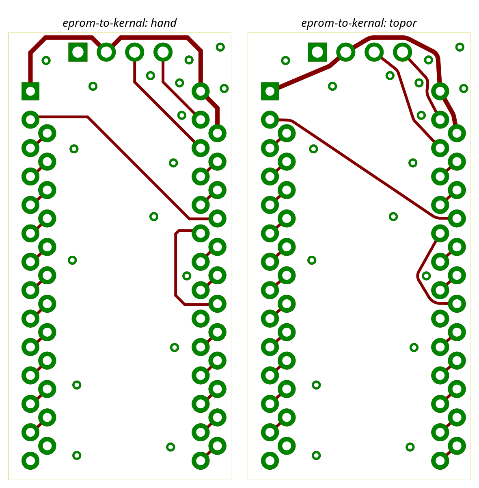

# Run 2026-10-31 — topor 0.2.0 (M2 single-layer router)

Engine `topor-engine` 0.2.0 (single-layer F.Cu PathFinder router, taut/arc smoother), KiCad 10.0.8.
Run is `run_bench(router=route_router, rip="all")` on copies of the benchmark boards: all tracks are ripped
(stitching/free vias, zones, keepouts and outline kept), the engine re-routes on F.Cu only, KiCad DRC with zone refill.
eprom-to-kernal ran via `tools/bench.sh eprom-to-kernal <dir> --rip all --router topor`; the other boards ran via
`run_bench(..., options={"wall_clock_s": 60, "partial_routes": False})` (the CLI has no options flag; nametag-sao and
wedding-gift via `pcb_override` on scratch copies of the project directories, sources untouched).
Structure follows [0.1.0](../2026-10-30-topor-0.1.0/README.md).

## Metrics

| Board | Routed / connections | Nets routed / total | Partial / failed | Segs / arcs | Outside-pad length vs hand | KiCad track+arc vs hand (info) | DRC routing_new | Unconnected | router_s / runtime | Iterations | Clinches | zero_slack_wires |
|---|---|---|---|---|---|---|---|---|---|---|---|---|
| eprom-to-kernal | **27 / 27** | **25 / 25** (GND pour-served) | **0 / 0** | 40 / 13 | **67.095 mm vs 76.598 mm** | 110.564 mm vs 112.886 mm | **0** | **0** | 0.158 s / 8.4 s | 16 | 0 | 1 (wire 24, +5V, kept, DRC accepted) |
| wiccon-2023 (info) | 8 / 60 | 4 / 27 | 0 / 52 | 13 / 5 | 368.262 mm vs 1690.138 mm | 380.742 mm vs 1831.971 mm | 0 | 49 | 0.026 s / 8.4 s | 1 | 0 | 0 |
| dcsgonebadge (info) | 24 / 231 | 8 / 66 | 0 / 207 | 47 / 23 | 232.422 mm vs 3890.918 mm | 260.907 mm vs 4210.279 mm | 0 | 190 | 44.356 s / 59.4 s | 9 | 0 | 0 |
| nametag-sao (info, user board) | 17 / 31 | 0 / 6 | 0 / 14 | 80 / 63 | 937.395 mm vs 1086.795 mm | 967.587 mm vs 1137.066 mm | 0 | 14 | 44.247 s / 53.7 s | 30 | 0 | 0 |
| wedding-gift (info, user board) | 32 / 81 | 20 / 43 | 0 / 49 | 59 / 27 | 323.188 mm vs 226.124 mm | 369.722 mm vs 259.522 mm | 0 | 49 | 0.112 s / 8.2 s | 4 | 0 | 0 |

"Partial" is the connection-level count (the run uses `partial_routes: false`); at net level wiccon-2023 has 2 partial
nets, dcsgonebadge 10, nametag-sao 3, wedding-gift 1 (nametag-sao: 17 nets complete, 1 pour-served). Unconnected counts are KiCad ratsnest items (they equal the failed connections except dcsgonebadge: 190 vs 207; nothing is
left dangling; `routing_new` 0 on all boards).

## M2 gate criteria (plan Global Constraints "M2 gate numbers") — eprom-to-kernal

| Criterion | Value |
|---|---|
| nets routed 25/25 (GND pour-served, not counted) | 25 / 25, GND `pour_served` |
| connections routed = all | 27 / 27 |
| partial == 0, failed == 0 | 0, 0 |
| `routing_new == 0`, unconnected 0 after `--refill-zones` | 0, 0 |
| width_match compared == matched == 25 | 25 / 25 |
| arcs >= 1, no `SS` pattern | 13 arcs |
| `length_outside_pads_nm` <= hand | 67.095 mm <= 76.598 mm |
| `router_s` < 2.0, threads_used 1, timed_out false | 0.158 s (gate run: 0.169 s), 1, false |
| iterations <= 50 | 16 |
| two runs byte-identical | asserted by `tests/gate/test_m2_gate.py`; not re-measured in this benchmark run |

**The M2 gate is closed.** Scaling `pytest tests/scaling -m scaling`: n=10 0.002 s 10/10 (1 it), n=100 0.0352 s 100/100
(2 it), n=1000 0.5704 s 1000/1000 (7 it), t100/t10 17.20 (<= 40), t1000/t100 16.21 (<= 30), no timeout: PASS (verified by
the coordinator at b8444a6; fixes B1 c65a5df slot-faithful metrization, B2 b8444a6 incremental metrization, B3 5578d9b).
Gate at b8444a6: 10 passed; eprom 27/27 connections, 25/25 nets, outside-pad 67.095 mm, KiCad 110.564 mm, arcs 13,
router_s 0.169, 16 iterations, zero_slack_wires 1 [+5V].

## Images

eprom-to-kernal, hand (left) vs topor (right), zone fills removed:

Further images in `images/`: `*-hand.png`, `*-topor.png`, `*-compare.png` for eprom-to-kernal, wiccon-2023, dcsgonebadge, nametag-sao, wedding-gift.
Progress images of this gate (after B1-B3): [eprom](../progress/2026-10-31-m2-gate-B12.png), [nametag-sao](../progress/2026-10-31-m2-gate-B12-nametag-sao.png), [wedding-gift](../progress/2026-10-31-m2-gate-B12-wedding-gift.png). Earlier (before B1-B3) progress images: [eprom](../progress/2026-10-31-m2-gate.png),
[nametag-sao](../progress/2026-10-31-m2-gate-nametag-sao.png), [wedding-gift](../progress/2026-10-31-m2-gate-wedding-gift.png).

## Observations

- eprom-to-kernal: all 27 connections routed on F.Cu, 0 new DRC routing violations, 0 unconnected, outside-pad length
  9.5 mm (12.4 %) below hand. One zero-slack wire (`+5V` wire 24) is kept (DRC accepted). The solver stalled after 16
  iterations (no better routing for 8), warning `routable layers B.Cu unused`.
- Single-layer router: connections whose terminals have no F.Cu copper or that need a layer change are left unrouted
  on the 2-layer boards. That is expected and informational (M3 adds layers). All failed connections are reported
  as failed, nothing dangling.
- wiccon-2023: 8 / 60 routed (most parts sit on B.Cu, terminal not on layer F.Cu). 0.026 s, unchanged by B1-B3.
- dcsgonebadge: 24 / 231 routed (was 22), 44.4 s router time within the 60 s wall clock (not timed out), 9 iterations, stalled; one zero-slack
  candidate rejected (`infeasible at margin 0: self-check: hole ...`). Width match 14 / 18 compared nets (informational).
- nametag-sao: 17 / 31 routed (was 14), 0 / 6 nets complete, 30 iterations (stalled), 44.2 s. Outside-pad length 937 mm vs 1087 mm hand
  (was 684 mm; more connections routed now, long diagonal pairs).
- wedding-gift: 32 / 81 routed, 20 / 43 nets (4 iterations, 0.11 s). Routed length (323 mm) exceeds the hand length (226 mm) although fewer
  connections are routed: the hand board is not fully connected (58 unconnected items in the hand board) and the
  router routes many connections the hand board leaves open. Not a gate criterion.
- Raw data: [metrics/](metrics/).
