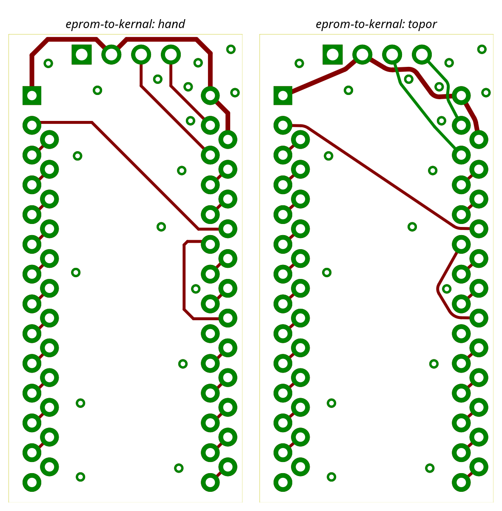
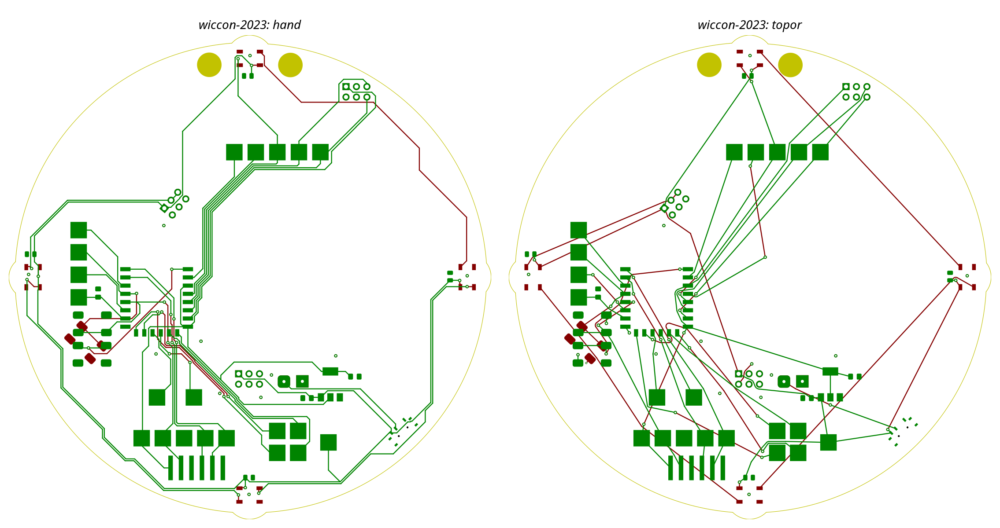

# Run 2026-10-31 — topor 0.3.0 (M3 two-layer router)

Engine `topor-engine` 0.3.0 (two-layer PathFinder router with vias, pour completion, via reduction, rayon batches), KiCad 10.0.8.
Run is `run_bench(router=route_router, rip="all", threads=4)` on copies of the pinned benchmark snapshots: all tracks are ripped
(stitching/free vias, zones, keepouts and outline kept), the engine routes F.Cu + B.Cu, KiCad DRC with zone refill.
eprom-to-kernal and wiccon-2023 use the M3 gate defaults (`options` none / `{"partial_routes": False}`, as in `tests/gate/test_m3_gate.py`);
dcsgonebadge, nametag-sao and wedding-gift use `options={"wall_clock_s": 60, "partial_routes": False}`. bornhack2026 (optional) was not run.
Structure follows [0.2.0](../2026-10-31-topor-0.2.0/README.md). Raw runs are in `work/` (not committed).

## Metrics

| Board | pcb sha12 | Routed / connections | Nets routed / total | Partial / failed | Segs / arcs | Vias (router / all) | F.Cu / B.Cu mm | Outside-pad length vs hand | DRC routing_new | Preexisting (routing) | preexisting_unconnected | Unconnected | router_s / runtime | Iterations | Threads | via_reduction | zero_slack_wires | Detour median / p90 / max / count > 1.5 | Top detour offender |
|---|---|---|---|---|---|---|---|---|---|---|---|---|---|---|---|---|---|---|---|
| eprom-to-kernal | bfaf705c0f25 | **27 / 27** | **25 / 25** (GND pour-served) | **0 / 0** | 40 / 13 | 0 / 17 | 90.323 / 17.773 | **64.628 mm vs 76.598 mm** | **0** | 0 | 0 | **0** | 0.058 s / 10.4 s | 1 | 4 | removed 0 of 0 vias in 0 candidates | 0 | 1.00 / 1.03 / 1.312 / 0 | A11 (1.312) |
| wiccon-2023 | 2d3063e70ed5 | **62 / 62** (signal-only 57 / 57) | 27 / 27 | 0 / 0 | 162 / 66 | 37 / 48 | 666.280 / 857.316 | 1373.553 mm vs 1690.138 mm | **0** | 0 | 0 | **0** | 3.337 s / 14.2 s | 26 | 4 | removed 2 of 35 vias in 20 candidates | 0 | 1.00 / 1.088 / 1.449 / 0 | RST (1.449) |
| dcsgonebadge (info) run 1 | 3e7e66f862a7 | 148 / 231 (signal-only 114 / 196) | 21 / 66 | 0 / 83 | 321 / 91 | 102 / 108 | 389.042 / 484.327 | 708.992 mm vs 3574.745 mm | 0 | 4 (clearance) | 53 | 87 | 60.186 s / 79.5 s (timed out) | 1 | 4 | skipped: timeout | 0 | 1.00 / 1.374 / 3.491 / 12 (n 148, 83 without reference) | USB+ (3.491) |
| dcsgonebadge (info) run 2 | 3e7e66f862a7 | 148 / 231 | 21 / 66 | 0 / 83 | 321 / 91 | 102 / 108 | 389.042 / 484.327 | 708.992 mm vs 3574.745 mm | 0 | 4 (clearance) | 54 | 87 | 60.162 s / 79.8 s (timed out) | 1 | 4 | skipped: timeout | 0 | 1.00 / 1.374 / 3.491 / 12 | USB+ (3.491) |
| nametag-sao (info, user board) | ca9b0acc5ff0 | 32 / 32 | 7 / 7 | 0 / 0 | 91 / 56 | 4 / 39 | 641.002 / 394.466 | 980.199 mm vs 1086.795 mm | 0 | 0 | 0 | 0 | 2.199 s / 14.9 s | 19 | 4 | removed 0 of 3 vias in 2 candidates | 0 | 1.002 / 1.055 / 1.073 / 0 | SDA (1.073) |
| wedding-gift (info, user board) | 683d3088a14f | 70 / 81 (signal-only 40 / 51) | 34 / 43 | 0 / 11 | 153 / 54 | 57 / 57 | 394.727 / 174.393 | 490.566 mm vs 226.124 mm | 0 | 16 (copper_edge_clearance) | 6 | 14 | 60.096 s / 70.5 s (timed out) | 10 | 4 | skipped: timeout | 0 | 1.00 / 1.311 / 1.659 / 2 (n 70, 11 without reference) | Net-(Q1-Pad2) (1.659) |

"Vias (router / all)": vias placed by the router / all vias on the routed board (router + kept free/stitching vias). "Preexisting (routing)"
are DRC violations of router copper that already exist in the ripped baseline and are not caused by new routing; `routing_new` is the gate figure.
"Detour" is routed length / feasible reference length per connection (M3-R15; connections without a feasible reference are excluded).

## M3 gate criteria — eprom-to-kernal (plan "M3 gate numbers")

| Criterion | Value |
|---|---|
| nets routed 25/25 (GND pour-served) | 25 / 25, GND `pour_served` |
| connections routed = all (27 at last measurement) | 27 / 27 |
| partial == failed == 0 | 0, 0 |
| `routing_new == 0`, `unconnected_items == 0` after refill | 0, 0 |
| width_match 25/25 | 25 / 25 |
| arcs >= 1, no `SS` pattern | 13 arcs (no `SS` is asserted by the gate test, not re-checked here) |
| `length_outside_pads_nm` <= hand | 64.628 mm <= 76.598 mm |
| `router_s` < 2.0 | 0.058 s |
| iterations <= 50, timed_out false, threads_used 4 | 1, false, 4 |
| zero_slack_wires target 0 (M3-R4, printed) | 0 |
| threads 1/2/4 and repeat byte-identical | asserted by `tests/gate/test_m3_gate.py`, not re-measured here |

## M3 gate criteria — wiccon-2023

| Criterion | Value |
|---|---|
| routed >= 0.9 * `connections_total` (incl. pour completion, M3-R5) | 62 / 62 (100 %) |
| signal-only ratio (to.kind != pour), printed | 57 / 57 |
| `routing_new == 0` | 0 |
| `router_s` < 10.0 | 3.337 s |
| `timed_out == false` | false |
| `unconnected_items` (printed) | 0 (preexisting_unconnected 0) |
| threads 1 vs 4 byte-identical | asserted by the gate test, not re-measured here |

## Other criteria and rulings

- **M3-R13**: dcsgonebadge is informational (robustness board): no crash, anytime result present, `routing_new == 0`; router_s <= 65 and the routed count are printed, not asserted.
- **M3-R14**: dcsgonebadge is a hard **M4 gate**: 231 / 231 connections, 0 DRC, <= 10 min. Not met at M3 (148 / 231 in 60 s).
- Locked-copper behaviour (locked tracks/vias are kept and respected as obstacles) is covered by `tests/test_locked_copper.py`, not by this benchmark (no board here has locked copper: `kept_locked_tracks` 0).

## Images

eprom-to-kernal, hand (left) vs topor (right), zone fills removed:

wiccon-2023:

Further images in `images/`: `*-hand.png`, `*-topor.png`, `*-compare.png` for eprom-to-kernal, wiccon-2023, dcsgonebadge, nametag-sao, wedding-gift.
Gate progress images: [eprom](../progress/2026-10-31-m3-T12-gate.png), [wiccon-2023](../progress/2026-10-31-m3-T12-gate-wiccon.png).

## Observations

- eprom-to-kernal: 27 / 27 connections, 0 routing_new, 0 unconnected. 90.3 mm on F.Cu and 17.8 mm on B.Cu with no router vias (the 17 kept free vias are used);
  outside-pad length 64.6 mm vs 76.6 mm hand (M2, F.Cu only: 67.1 mm). Converged in 1 iteration, 0.058 s (M2: 0.158 s, 16 iterations). Max detour 1.31 (A11).
- wiccon-2023: 62 / 62 (M2: 8 / 60) incl. 5 pour-completion connections; 27 / 27 nets. 37 router vias (48 total), via reduction removed 2 of 35 vias (20 candidates). 857 mm on B.Cu, 666 mm on F.Cu.
  3.3 s in 26 iterations. Max detour 1.45 (RST), none > 1.5.
- dcsgonebadge: two consecutive runs both routed 148 / 231 in 60 s (timed out, anytime result, via reduction skipped), router_s 60.186 s / 60.162 s. Same as the 148 measured
  earlier today at fdf8c10; the pour-reach commit 4bb63a1 did not lower it in these runs (one earlier run at that commit gave 110 / 231; not reproduced). 12 connections have detour > 1.5 (max 3.49, USB+); 83 failed connections.
  4 preexisting clearance violations; routing_new 0. preexisting_unconnected 53 / 54 between the two runs (KiCad ratsnest count differs by 1). M2 was 24 / 231.
- nametag-sao: 32 / 32 (M2: 17 / 31), 7 / 7 nets, 4 router vias, 2.2 s, 19 iterations, max detour 1.07.
- wedding-gift: 70 / 81 (M2: 32 / 81), 34 / 43 nets, timed out at 60 s with 10 iterations; 11 failed. 16 preexisting copper_edge_clearance violations (routing_new 0), 6 preexisting unconnected.
  The hand board is not fully connected, so the routed length (491 mm outside pads) is not comparable with the hand 226 mm. Informational.
- Raw data: [metrics/](metrics/).
