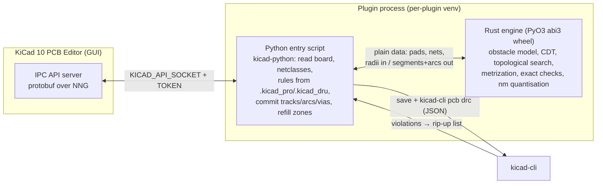

# 31 — Rust engine and KiCad integration (Linux first)

How a Rust routing engine can be connected to KiCad 10, which integration shapes exist, what
the Rust ecosystem offers for the algorithms in this library, and what Rust does and does not
buy in stability and speed. Scope decided by the user: **Linux only for now**; target path =
Python IPC plugin + Rust engine delivered as a PyO3/maturin wheel that a build script places
**inside the KiCad plugin directory** (not published to PyPI). Verified 2026-10-30 against
KiCad `10.0` sources, dev-docs.kicad.org, pip/packaging sources, crates.io and docs.rs;
UNVERIFIED where noted. Companion to [30 — KiCad constraints](30-kicad-constraints.md).

---

## 1. Question and short answer

**Question.** How can the router interact with KiCad, and can the engine be written in Rust
so that it is more stable and faster than Python?

**Short answer.** Yes on both counts, with one mechanical caveat. KiCad 10 talks to plugins
only through the IPC API (protobuf over NNG) and launches either a Python script in a
per-plugin virtualenv or an arbitrary executable. A Rust engine fits either shape. The
recommended shape is a **thin Python plugin (kicad-python) that imports a Rust extension
module**: the Python side owns the KiCad conversation (board read, commit, zone refill,
DRC loop), the Rust side owns everything geometric and combinatorial. KiCad's wheel-only
dependency installer **can** install a wheel shipped in the plugin directory, provided the
`requirements.txt` uses a `--find-links` line (pip resolves that relative to the requirements
file) rather than a bare relative wheel path (resolved against KiCad's unpredictable working
directory). Rust removes the pure-Python performance risk and whole classes of crashes, but
**not** floating-point robustness, algorithmic failure modes or the need to map panics to
errors.

## 2. Integration architectures

| | Shape | KiCad side | Rust side | Pros | Cons |
|---|---|---|---|---|---|
| **A** | Python IPC plugin + Rust extension module (**recommended**) | `plugin.json` runtime `python`; KiCad creates venv, installs `requirements.txt` from wheels | PyO3 + maturin, abi3 wheel shipped in the plugin dir | Mature client (kicad-python 0.8.0, API 10.0.6); one process; Rust does the heavy work; Python keeps glue, UI, DRC loop; easy tests through the wheel | Wheel must be built per OS/arch; venv install path has pip subtleties (§3.2); Python ↔ Rust data marshalling |
| **B** | Pure Rust executable as the plugin | `plugin.json` runtime `exec`; KiCad runs the binary with `KICAD_API_SOCKET` / `KICAD_API_TOKEN` in the environment | Rust IPC client (`kicad-ipc-rs` 0.5.1, MIT, beta; or generated from KiCad's `.proto` with prost + an NNG binding) | No Python at all; single static binary | Rust IPC clients are young (first release Feb 2026); the NNG binding builds the NNG C library (CMake + C compiler); no UI toolkit for free; code-signing questions off-Linux |
| **C** | Standalone Rust CLI on `.kicad_pcb` files + `kicad-cli pcb drc` | None while running; KiCad only reloads the file | S-expression read/write (`kiutils_kicad` 0.3.0 MIT "lossless round-trips", or own parser) | Headless, CI/batch friendly, no API version coupling | Unsafe while the board is open in KiCad (no undo, file clobber); must re-implement padstack/zone semantics the API gives for free; KiCad 10 file format changes (nets by name) |
| **D** | A + a CLI front-end over the same Rust crate | Both | Same engine crate exposed twice | Batch and interactive use from one core | Two front-ends to keep in sync |

A is the baseline; C/D are cheap additions later because the engine crate stays independent
of KiCad (as [30 §6](30-kicad-constraints.md#6-plugin-platform-constraints) already
recommends). B is viable but currently buys little over A on Linux.

### 2.1 How KiCad 10 launches a plugin (verified in `common/api/api_plugin_manager.cpp`)

- **Both runtimes.** KiCad copies its own environment, adds `KICAD_API_SOCKET` (path of the
  socket/named pipe) and `KICAD_API_TOKEN` (unique per running KiCad instance), sets the
  working directory to the **entrypoint's directory**, and starts the process asynchronously
  with a hidden console. A non-zero exit code is reported as "exited with code N"; trimmed
  stderr is shown as an error message; stdout is captured but not shown.
- **`exec`.** The entrypoint must be an executable file ("entrypoint '…' is not executable"
  otherwise). It is run directly, with the action's `args` appended. `plugin.json` has a
  single `entrypoint` per action — **no per-OS entrypoint and no `platforms` field** — so a
  cross-platform exec plugin needs a launcher script that picks the binary itself.
- **`python`.** The venv's interpreter runs the entrypoint; `VIRTUAL_ENV` is set; action
  `args` are **not** passed. Before the first run KiCad executes a three-job pipeline:
  create the venv with the configured interpreter (`-m venv --system-site-packages`),
  upgrade pip, then install requirements with
  `-m pip install --no-input --isolated --only-binary :all: --require-virtualenv
  --exists-action i -r <plugin_dir>/requirements.txt`. The install jobs set **no working
  directory** (they inherit whatever KiCad's cwd happens to be) and only `VIRTUAL_ENV`.
  On Linux the default interpreter (`scripting/python_manager.cpp`, `FindPythonInterpreter`)
  is the build-time `PYTHON_EXECUTABLE` if executable, else the first hit of `which -a python3`,
  else `which -a python`; the user can override it (`api.interpreter_path` in
  `kicad_common.json`, verified locally as `/usr/bin/python3`, Python 3.12.3, KiCad 10.0.8).
- **Where things live on Linux.** User plugins:
  `${KICAD_DOCUMENTS_HOME}/<major.minor>/plugins/<dir>` (default documents root from
  GLib `g_get_user_data_dir`, i.e. `~/.local/share/kicad/10.0/plugins`; PCM-installed plugins
  under the versioned `3rdparty` path). Venvs:
  `${KICAD_CACHE_HOME}/<major.minor>/python-environments/<identifier>` (default cache root from
  `g_get_user_cache_dir`, i.e. `~/.cache/kicad/10.0/…`). The dev-docs quote the
  capitalised spelling `~/.local/share/KiCad/…`, but a KiCad 10.0.8 install on Ubuntu 24.04
  uses lowercase `~/.local/share/kicad/` and `~/.cache/kicad/` (verified locally). A build
  script should still honour `KICAD_DOCUMENTS_HOME` / `KICAD_CACHE_HOME` when set.
- A plugin's environment can be rebuilt from the PCB Editor preferences (right-click on the
  plugin action, "Recreate Plugin Environment"), which deletes the venv and re-runs the
  pipeline.

## 3. Recommended path in detail: Python plugin + local Rust wheel

### 3.1 Can KiCad's installer pick up a wheel inside the plugin directory? — Yes, one way

Facts from pip's requirements-file parser (`req_file.py`, `handle_option_line`):

- A `--find-links <path>` line inside a requirements file with a **relative** path is first
  joined to the **requirements file's directory**; if that directory exists it is used,
  otherwise the value is kept as given (then relative to the cwd). So
  `--find-links wheels` + a normal `name==version` requirement line reliably finds
  `<plugin_dir>/wheels/<name>-<version>-…whl`, whatever cwd KiCad happens to have.
- A **bare relative wheel path as a requirement line** is *not* rebased onto the requirements
  file; it is resolved against the process cwd, which KiCad does not set for the install job
  → fragile, do not use.
- `--isolated` only ignores environment variables and user configuration; it does not disable
  options inside the requirements file. `--only-binary :all:` is satisfied by a wheel.
  `--exists-action i` ignores an already-present install.
- Robust alternatives if ever needed: an absolute `--find-links` or a PEP 508
  `name @ file:///abs/path.whl` line written by the install script at install time (the
  path is known then); both are cwd-independent. `--no-index` can be added to force
  offline resolution, but then **all** dependencies (kicad-python, protobuf, pynng, …) must
  also be present as wheels in the same directory — simpler to leave index access on and let
  `--find-links` win for the engine package only. Version-pin the engine in
  `requirements.txt` so an older copy on an index can never shadow the local wheel.

### 3.2 Wheel tag and Python version on Linux

- **Platform tag.** `maturin build --release` audits the resulting shared object; the default
  tag is the lowest manylinux level the binary complies with, and it **falls back to the native
  `linux` tag** (e.g. `linux_x86_64`) if it does not comply — for instance when the build host's
  glibc is newer than the manylinux target. `--compatibility linux` forces that tag. pip
  **accepts** native `linux_x86_64` wheels: `packaging.tags` lists `linux_<arch>` among the
  supported platform tags before the manylinux variants (PyPI is the only place that rejects
  them). For a wheel built and used on the same machine this is therefore a non-issue; for a
  wheel shared between Linux machines, build against an older glibc (manylinux container or
  maturin's `--zig`) to keep a manylinux tag.
- **ABI tag.** Build with PyO3's `abi3-py39` feature (kicad-python requires Python ≥ 3.9)
  → tag `cp39-abi3-linux_x86_64`, installable on every GIL-enabled CPython ≥ 3.9 without
  rebuilding when the system Python changes (pip derives `abi3` tags for all interpreter
  versions down to the minimum). Free-threaded (`t`) interpreters do not accept `abi3`
  wheels; a `-t` system Python would need a version-specific build (edge case, note only).
- **Why this matters on Linux.** KiCad uses the system `python3` by default, so the ABI is the
  distribution's; an abi3 wheel decouples the plugin from distro upgrades. Rust itself is
  statically linked except libc, so a wheel has no other runtime dependencies.

### 3.3 Build-and-deploy steps for the build script (prose, no code by design)

| Step | What the script does | Notes |
|---|---|---|
| 1 | Build the engine crate with maturin in release mode, abi3 (`abi3-py39`), optionally `--compatibility linux` | Produces one `.whl` in `target/wheels`. Rust toolchain + maturin (pip or cargo) required on the dev machine only. |
| 2 | Resolve the KiCad user plugin directory: `${KICAD_DOCUMENTS_HOME}` if set, else `g_get_user_data_dir` (`$XDG_DATA_HOME` or `~/.local/share`) + `kicad/10.0/plugins` | Same rule KiCad uses; do not hard-code. |
| 3 | Create `<plugins>/<reverse-dns-id>/` and copy `plugin.json`, the Python entry script(s), `requirements.txt`, icons, and the wheel into `<…>/wheels/` | `plugin.json`: runtime type `python`, relative `entrypoint`, reverse-DNS `identifier` (at least three labels). |
| 4 | Write `requirements.txt`: `--find-links wheels` on its own line, then `kicad-python` (pinned) and the engine package pinned to the exact version just built | Pin bump on every build forces pip to reinstall even with `--exists-action i`. |
| 5 | Remove stale wheels of the engine from `wheels/` | Avoids pip choosing an older file. |
| 6 | Tell the user to restart the PCB Editor or use "Recreate Plugin Environment"; optionally delete `${KICAD_CACHE_HOME}/kicad/10.0/python-environments/<identifier>` so KiCad rebuilds from scratch on next start | KiCad only runs the pip job on plugin (re)load. |

Also worth a design note: the Python entry script should check at start-up that the imported
engine module's version matches the one it was shipped with (KiCadRoutingTools does the
same with its Rust library) and fail with a clear message on stderr, which KiCad surfaces.

### 3.4 Development loop

| Situation | Fastest route |
|---|---|
| Rust engine changed, interface unchanged | Rebuild wheel; run the venv's own pip (interpreter under `python-environments/<id>/bin`) with `install --force-reinstall --no-deps <wheel>`; re-run the plugin action. No KiCad restart. |
| Interface or dependencies changed | Rebuild, bump version, copy, then "Recreate Plugin Environment" (or delete the venv dir and reload plugins). |
| Pure engine work | Test the Rust crate with `cargo test` and the wheel with pytest against fixture boards, without KiCad; the plugin layer is only exercised in the end-to-end DRC loop. |
| Debugging against a live board | Run the entry script from a terminal with `KICAD_API_SOCKET`/`KICAD_API_TOKEN` copied from a running KiCad (dev-docs describe this for IDE use). |

Keep the engine's public surface small and plain (arrays of pads/obstacles/nets in, arrays of
segments/arcs/vias out) so the PyO3 layer stays thin and the same crate can later back a CLI
(shape D) or an `exec` plugin (shape B) without change.

## 4. Alternatives, briefly

- **Rust `exec` plugin.** Two client crates exist: `kicad-api-rs` 0.1.0 (official
  `gitlab.com/kicad/code/kicad-rs`, GPL-3.0-or-later, one release June 2025, 57 commits — a
  seed, not a product) and `kicad-ipc-rs` 0.5.1 (MIT, Feb–May 2026, "beta", claims all 59
  KiCad 10.0.1 commands including begin/end commit, create/update/delete items, zones with
  refill, netclasses; ships generated protobuf code so no KiCad checkout is needed; uses the
  `nng` crate 1.0.1 → `nng-sys` 1.4, which builds the NNG C library from source, needing
  CMake and a C compiler at build time). Generating one's own client from KiCad's `api/proto`
  with prost is routine; the NNG side is the only non-Rust piece — a pure-Rust NNG/SP
  protocol implementation was **not found** (UNVERIFIED). Without a GUI toolkit the plugin
  would have no dialogs; a Rust `exec` plugin is attractive mainly for KiCad 11 headless use.
- **File-based CLI.** `kiutils_kicad` 0.3.0 (MIT, 2026) promises lossless round-trips of
  KiCad documents; `kicad_parse_gen` (2018) and `serde_kicad_sexpr` (2022) are stale. Any of
  these needs validation against KiCad 10's net-by-name format. Fine for CI/batch, wrong for
  interactive use.
- **Distribution via PCM.** The package metadata schema (v1 and v2) has **no platform field**
  and one `download_url` per version; the official repository requires open-source,
  GPL-compatible code and makes no provision for native binaries. A PCM package would thus
  carry wheels for every supported OS/arch/ABI in one archive, with `requirements.txt`
  pointing at them as above — feasible, but a "later" item outside the Linux-only scope.

## 5. Rust ecosystem fit for the engine

All crates below are MIT and/or Apache-2.0 unless stated; versions and dates from crates.io
(2026-10-30).

| Need (doc) | Crate | Status | Fit / caveats |
|---|---|---|---|
| CDT with insertion **and removal**, exact predicates ([10](../topology/10-triangulation-and-cuts.md)) | `spade` 2.15 | mature, uses `robust` for predicates | `ConstrainedDelaunayTriangulation` with vertex `remove` (O(deg²), invalidates handles), `remove_constraint_edge`, `add_constraint_and_split` for crossing constraints; `add_constraint` panics on crossings → use the `try_`/split variants. Coordinates limited to ±2^201 and ≥ 2^-142 in magnitude: integer-nm boards as f64 are far inside. |
| Robust orientation/incircle ([23](../geometry/23-distance-and-drc-checks.md)) | `robust` 1.2 | Shewchuk port, widely used | Exact sign of orientation/in-circle only; distances between arcs still need the integer/rational reasoning of 23. |
| Spatial index | `rstar` 0.13 | mature | R*-tree with bulk load, nearest-neighbour, envelope queries. |
| Polygon booleans (pad polygons, zone cut-outs) | `i_overlay` 9.1 | active, fast; integer and float APIs, optional rayon | Straight edges only; arcs must be polygonised like KiCad does (5 µm). |
| **Arc-aware offsetting** ([20](../geometry/20-clearance-model.md), [24](../geometry/24-length-diffpairs-tuning.md)) | `cavalier_contours` 0.9 | Rust rewrite of the C++ library | Polylines with per-vertex bulge (true arcs), parallel offset preserves arcs, shape offset with holes, union/intersect/difference of two closed polylines; bulge limited to half-circles, rounded joins only. Useful for diff-pair offset and clearance hulls, not a clearance kernel by itself. |
| Curves, biarcs ([22](../geometry/22-smoothness-and-biarcs.md)) | `kurbo` 0.13 | mature (Linebender) | Arcs, Béziers, offset, fitting; biarc construction is small enough to write directly. |
| Graph search ([11](../topology/11-homotopic-shortest-paths.md), [12](../topology/12-sketch-generation.md)) | `petgraph` 0.8, `pathfinding` 4.16 | mature | A*/Dijkstra generic over a closure-defined graph; the routing graph over triangle edges fits. |
| Via minimisation / assignment ILP ([13](../topology/13-vias-and-layers.md)) | `good_lp` 1.15 (front-end) with `highs` 2.4 (MIT, builds HiGHS C++ via CMake) or `russcip` 0.11 (Apache-2.0, SCIP); `cp_sat` 0.4 (Apache-2.0) wraps OR-Tools CP-SAT but needs the OR-Tools native library | usable | Every exact solver is a C/C++ build dependency inside the wheel; start with heuristics and add a solver behind a feature flag. |
| Parallelism | `rayon` 1.12 | mature | Per-net/per-layer work and the exact self-check parallelise cleanly; no GIL involved inside Rust. |
| Python bridge | `pyo3` 0.30, `maturin` 1.16 | mature | abi3 support; releasing the GIL around long calls lets the Python side keep the IPC connection and progress UI alive. |
| KiCad IPC client in Rust | `kicad-ipc-rs` 0.5.1, `kicad-api-rs` 0.1.0 | beta / seed | Only for shape B. |

### 5.1 Topola as a source of parts

> **Decision (user, 2026-10-30): do not build on Topola.** Option C: own engine; Topola is read as a reference for ideas only — no code dependency, no fork. See [43](../design/43-topola-assessment.md).

Topola (`codeberg.org/mikolaj/topola`, default branch `develop`, last commit 2026-07-02,
MIT; `math.rs` MIT-or-Apache-2.0; NLnet-funded) is a Cargo **workspace**: the root `topola`
library crate (0.1.0) plus `crates/planar-incr-embed` (incremental planar embedding),
`crates/specctra-core` and `specctra_derive` (DSN/SES parsing), `topola-cli` and
`topola-egui` (front-ends). It depends on `spade` 2.13, `rstar`, `geo`/`geo-types`, a
forked `petgraph`, `contracts-try`, `enum_dispatch`, `ron`/`serde`, and is tested with
`proptest`/`rstest`. Observations:

- Being a library crate with separate front-ends, it is embeddable as a Cargo path/git
  dependency; it is not published on crates.io (UNVERIFIED) and has no stability promise
  ("work in progress", 0.1.0).
- Components named in earlier notes as "Cyrk exact kernel" and "navmesh" were **not found as
  separate crates** in the current workspace listing — they are either modules inside the root
  crate or have been renamed; UNVERIFIED and worth a code read before any reuse decision.
- Its rubber-band bend model (wrap/unwrap/squeeze/stack, see
  [42](../design/42-pitfalls-and-open-problems.md)) overlaps with
  [21](../geometry/21-tangent-arc-paths.md); `planar-incr-embed` and `specctra-core` are the
  most self-contained pieces. Reuse is realistic at the level of ideas and selected crates,
  not by linking the whole router: its data model is built around its own interactive
  workflow and DSN/SES exchange (which cannot carry arcs into KiCad,
  [30 §6](30-kicad-constraints.md#6-plugin-platform-constraints)).

## 6. What Rust buys, and what it does not

| Rust buys | Rust does not solve |
|---|---|
| **Memory safety without a GC**: no segfaults from indexing or aliasing bugs in a 20 k-line geometry kernel; data races are compile errors. | **Floating-point robustness.** The same wrong sign from a 1e-12 cancellation happens in Rust; exact predicates (`robust`), integer-nm arithmetic and margins ([23](../geometry/23-distance-and-drc-checks.md)) are still the design, not the language. |
| **Speed**: compiled, monomorphised geometry loops; KiCadRoutingTools reports ~10× for its A* core over pure Python and further gains from Rust rasterisers/clearance checks; 10–100× is the usual range for tight scalar loops versus interpreted Python (numpy-vectorised Python narrows the gap for bulk ops but not for branchy funnel/stack iteration). | **Algorithmic failure** — the metrization fixed-point not converging, stack order inversions, dense fan-in ([02 §5](../02-feasibility-study.md#5-risk-assessment)) are the same in any language. |
| **Real parallelism**: `rayon` inside the extension runs outside the GIL; per-net and per-layer work scales with cores. | **Panics must be handled.** A Rust panic inside a PyO3 call surfaces in Python as `pyo3_runtime.PanicException`, which derives from `BaseException` (not `Exception`) and therefore escapes ordinary `except Exception` handlers and can terminate the plugin process (KiCad then shows "exited with code N"). The engine must return `Result` errors for every expected failure, keep panics for true invariants, and the Python layer must catch `BaseException` at the top level. A `panic = "abort"` profile would kill the process outright — do not use it in the wheel. |
| **Deterministic resource use**: no GC pauses; large boards (10⁵ pads, 10⁶ triangle edges) fit comfortably in typed, contiguous storage. | **Prototyping speed.** Algorithms change often in the first months; Rust's edit-compile cycle and ownership model slow exploratory work compared with Python. Mitigation: prototype each algorithm as a self-contained Rust module with property tests (`proptest`, as Topola does) instead of a Python prototype that is later ported. |
| **One artefact**: a static `.so` with no runtime dependencies beyond libc; wheels for other platforms are a CI matter, not a code one. | **Build machinery**: Rust toolchain, maturin, abi3/manylinux decisions, version pinning between Python and Rust halves — small but non-zero and must be owned (§3.3). |
| **API independence**: the engine knows nothing of KiCad; SWIG removal (KiCad 11) and IPC growth touch only the Python adapter. | **No DRC-rule engine access** — unchanged ([30 §2](30-kicad-constraints.md#2-can-a-plugin-read-everything-needed--mostly)). |

Speed figures other than KiCadRoutingTools' own statement are general experience and
UNVERIFIED for this router.

### 6.1 Multithreading (user-configurable thread count)

Multithreading is a requirement; the thread count is a **user setting** (default: number of
logical cores minus one, so KiCad and the desktop stay responsive; "1" gives a strictly
sequential run for debugging). 4 threads is the reference case used in this study.
Where the work parallelises (one rayon thread pool sized by that setting):

| Stage | Parallel unit | Notes |
|---|---|---|
| Obstacle model, triangulation | per copper layer | independent until vias are placed |
| Topological search (PathFinder rounds) | nets with non-overlapping regions in the same round | classic batch-parallel negotiated congestion; conflicting nets go to the next batch |
| Metrization / relaxation | wires in one iteration (Jacobi style: read old stacks, write new) | Gauss–Seidel converges faster but is sequential; Jacobi needs damping |
| Exact self-check | primitive pairs from the spatial index | embarrassingly parallel |
| **Multi-variant search** | **N complete routings (N = thread count) with different seeds / via costs** | TopoR's Pareto-variant idea ([12 §4](../topology/12-sketch-generation.md#4-rip-up-and-reroute--optimisation-topors-scheme)); best or user-picked result wins — the simplest way to use all threads well |
| KiCad DRC (`kicad-cli`) | separate process | can run on the previous iteration's result while the engine continues |

Constraints: results must be **reproducible** (fixed seeds, deterministic merge order of
parallel results); memory per variant is small at PCB scale; the Python side only waits
(GIL released during engine calls), so KiCad's UI is unaffected (separate process anyway).

### 6.2 GPU? — not a good fit (decision basis)

The work is irregular and small (graph search on triangulations of 10–30k vertices per layer,
short sequential funnels, nets coupled through shared stacks and a topology that changes after
every routed net). GPUs pay off for large regular grids (GPU maze/global routers for ICs such as
GAMER and FastGR work on millions of grid cells; details UNVERIFIED), not for this gridless,
branch-heavy search. Further: the engine needs f64 plus exact integer predicates (consumer GPUs
run f64 at 1/32–1/64 rate), and a CUDA/wgpu dependency complicates the wheel. The exact
clearance self-check is data-parallel but small enough (~10⁵–10⁶ pairs after the spatial index)
for CPU SIMD + threads. **Conclusion:** inner algorithms single-threaded and deterministic;
parallelism at the coarse level (variants, independent net batches, layers, DRC) on N CPU
threads (§6.1). Revisit GPU only for a learned cost model or a large grid-based congestion
pre-estimate.

## 7. Later: beyond Linux (short)

- **Wheels per platform.** maturin's GitHub action / `--zig` cross-builds produce manylinux,
  macOS (universal2 or per-arch) and Windows wheels; abi3 keeps it to one wheel per
  OS/arch. Bundled Python differs by OS (Windows/macOS use KiCad's bundled interpreter; forum
  reports give Windows 3.11 → 3.13 across 9.0.x and macOS 3.9.13 — UNVERIFIED), so the
  abi3 minimum should stay at 3.9 until KiCad's macOS bundle moves.
- **Signing/notarisation.** A Python extension inside a venv is loaded by Python, not launched
  by KiCad, which avoids Gatekeeper's "launched app" path; whether macOS quarantine flags on a
  downloaded `.so` block loading, and whether Windows SmartScreen interferes with an `exec`
  plugin binary, is UNVERIFIED and must be tested before any non-Linux release.
- **PCM packaging.** One archive with all wheels; `--find-links wheels` keeps working since pip
  picks the wheel matching the local tags. Official-repository review would need to accept a
  binary payload (policy UNVERIFIED).

## 8. Recommendation, risks, effect on estimates

**Recommendation.** Adopt shape A: Python plugin for KiCad I/O, Rust engine as an abi3 wheel
placed in the plugin directory by a build script, installed by KiCad through
`--find-links wheels` in `requirements.txt`. Write the engine crate so that it never imports
KiCad types; expose a small plain-data API through PyO3; release the GIL for long calls; map
every expected failure to a Rust error (→ Python exception), and catch `BaseException` at the
plugin's top level. Keep shape C/D (CLI over files + `kicad-cli` DRC) as a cheap follow-on
for CI and for KiCad 11 headless use; revisit shape B only if the Python layer proves
troublesome.

| Criterion | A: Python + Rust wheel | B: Rust exec plugin | C: Rust CLI on files |
|---|---|---|---|
| KiCad client maturity | kicad-python 0.8.0 (official) | kicad-ipc-rs 0.5.1 beta / kicad-api-rs seed | none needed; file-format crates young |
| Native code delivery | wheel via `--find-links` (verified mechanism) | executable, launcher needed off-Linux | executable |
| Build dependencies | Rust + maturin | Rust + CMake/C compiler (NNG) | Rust |
| Works while board is open | yes (API, undoable commit) | yes | no |
| Headless/CI | via C/D later; API headless only in KiCad 11 | KiCad 11 | yes |
| UI (dialogs, progress) | Python (wx/tk) or none | own toolkit | none |
| Fit for Linux-only now | best | ok | partial |

**Risks specific to this choice.**

| Risk | Likelihood | Impact | Mitigation |
|---|---|---|---|
| pip in the KiCad venv does not see the local wheel (cwd, tag, stale copy) | Medium at first | Low | `--find-links wheels` relative to the requirements file; abi3 + native `linux` tag; pin exact version; remove stale wheels; read KiCad's trace log. |
| Engine panic terminates the plugin mid-commit | Medium | Medium | `Result` everywhere, top-level `BaseException` catch, commit only after a full self-check; KiCad's commit is atomic/undoable. |
| Rust slows early algorithm exploration | Medium | Medium | Module-per-algorithm with property tests; keep interfaces plain; accept slower first weeks. |
| Solver (HiGHS/SCIP/CP-SAT) adds C++ to the wheel build | Low | Low | Heuristics first; solver behind a feature flag. |
| Distro Python moves to free-threaded or very new versions | Low | Low | abi3 covers GIL builds; version-specific fallback build if ever needed. |

**Effect on the estimates in [02 §6](../02-feasibility-study.md#6-effort-and-expected-quality-estimates-unverified).**
Add roughly 1–2 person-weeks for build/deploy infrastructure (maturin, script, version
pinning, trace-log debugging) and expect the first 1–2 months to run ~20% slower than a
Python prototype would. In exchange, delete the "performance in pure Python on 300+ nets"
risk from the risk table and remove the later "port the hot path to native" step that a
Python-first plan would need (typically a month or more once the prototype is stable). Net
effect on the 8–15 person-month figure for a 2-layer router: approximately neutral; on the
3–6 person-month taut-arc smoother: +0.5 month at most. The algorithmic risks that dominate
both estimates are unchanged.

## References

- KiCad 10 plugin manager (launch, venv, pip command, cwd, env vars):
  https://gitlab.com/kicad/code/kicad/-/raw/10.0/common/api/api_plugin_manager.cpp ;
  plugin.json parsing: https://gitlab.com/kicad/code/kicad/-/raw/10.0/common/api/api_plugin.cpp ;
  paths: https://gitlab.com/kicad/code/kicad/-/raw/10.0/common/paths.cpp and
  https://gitlab.com/kicad/code/kicad/-/raw/10.0/libs/kiplatform/os/unix/environment.cpp
- IPC API for add-on developers (env vars, interpreter per OS, plugin dir, recreate environment):
  https://dev-docs.kicad.org/en/apis-and-binding/ipc-api/for-addon-developers/
- PCM package metadata and repository policy: https://dev-docs.kicad.org/en/addons/
- kicad-python 0.8.0 (Python ≥ 3.9): https://pypi.org/project/kicad-python/
- pip requirements-file handling (`--find-links` rebased on the requirements file):
  https://github.com/pypa/pip/blob/main/src/pip/_internal/req/req_file.py ;
  requirements-file format: https://pip.pypa.io/en/stable/reference/requirements-file-format/ ;
  `--isolated`, `--require-virtualenv`: https://pip.pypa.io/en/stable/cli/pip/
- Wheel tags (`linux_<arch>` accepted; abi3 for all versions ≥ minimum):
  https://github.com/pypa/packaging/blob/main/src/packaging/tags.py
- maturin: abi3 features https://www.maturin.rs/bindings.html ; manylinux audit, `--compatibility linux`, zig:
  https://www.maturin.rs/distribution.html
- PyO3 `PanicException` (derives `BaseException`): https://docs.rs/pyo3/latest/pyo3/panic/struct.PanicException.html
- Rust KiCad clients: https://crates.io/crates/kicad-ipc-rs , https://github.com/Milind220/kicad-ipc-rs ,
  https://crates.io/crates/kicad-api-rs , https://gitlab.com/kicad/code/kicad-rs
- NNG bindings: https://crates.io/crates/nng , https://crates.io/crates/nng-sys
- KiCad file-format crates: https://crates.io/crates/kiutils_kicad , https://crates.io/crates/kicad_parse_gen
- Geometry/graph crates: https://docs.rs/spade/latest/spade/ (and `ConstrainedDelaunayTriangulation` page),
  https://crates.io/crates/robust , https://crates.io/crates/rstar , https://docs.rs/i_overlay/latest/i_overlay/ ,
  https://github.com/jbuckmccready/cavalier_contours , https://crates.io/crates/kurbo ,
  https://crates.io/crates/petgraph , https://crates.io/crates/pathfinding , https://crates.io/crates/rayon ,
  https://crates.io/crates/good_lp , https://crates.io/crates/highs , https://crates.io/crates/russcip ,
  https://crates.io/crates/cp_sat
- Topola: https://codeberg.org/mikolaj/topola (workspace `Cargo.toml`, `crates/` listing, branch `develop`)
- KiCadRoutingTools (Rust core ~10× over pure Python): https://github.com/drandyhaas/KiCadRoutingTools
